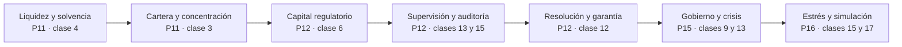

# Caso · Ueno Bank Paraguay: aprender sobre solvencia, riesgos, gobierno corporativo y resolución bancaria

**Tema:** insuficiencia de solvencia, resolución y garantía de depósitos ·
**Partes relacionadas:** 3, 5, 11, 12, 15 y 16 · **Naturaleza:** caso real
documentado, **en desarrollo** · **Fecha de hechos:** 2026-06-05 a 2026-11-04 ·
**Fecha de corte:** 2026-11-04 · **Fecha de consulta:** 2026-11-05

Entre el 2 y el 4 de noviembre de 2026 el Banco Central del Paraguay (BCP) inició
el procedimiento de resolución de ueno bank, una entidad que la prensa describe
como el quinto banco privado del país. Este expediente se escribió **cuando el
caso llevaba dos días de vida**: no hay informe final, balance de exclusión
publicado ni resolución judicial. Su valor didáctico no está en memorizar cifras
sino en **aprender a leer un caso bancario mientras se desarrolla**: qué dijo la
autoridad, qué dijo la prensa, qué es un cálculo del ejercicio y qué todavía nadie
sabe.

> ⚖️ **Aviso.** Este material usa fuentes públicas atribuidas y no valora la
> conducta de ninguna persona. Una investigación, una denuncia o una detención
> informadas por la prensa **no son una condena**. No se deduce ninguna causa
> técnica: «ajuste contable» no significa «fallo informático» ni «fraude probado».
> Las cifras de los ejercicios son **sintéticas**, y las normas deben verificarse en
> la fuente oficial vigente. No es asesoría legal, financiera ni de inversión.

## Cómo se separan los niveles

Un caso en desarrollo mezcla cinco tipos de enunciado que parecen iguales y no lo
son. Cada línea de este expediente lleva la etiqueta de su nivel, para que
quien lo estudie no confunda lo que *se sabe* con lo que *se cuenta*.

| Etiqueta | Qué significa | Cómo se usa en clase |
|---|---|---|
| **[H]** Hecho documentado | Lo afirma la autoridad en un comunicado o lo recoge, con su cita, una fuente periodística identificable | Se puede usar como dato de partida |
| **[D]** Declaración atribuida | Lo dice una persona o institución concreta; no está comprobado por un tercero | Se cita con su autor |
| **[P]** Pendiente o investigación | Está abierto: investigación, proceso, cifra no publicada | No se usa como conclusión |
| **[I]** Interpretación pedagógica | Lo añade este programa para enseñar un mecanismo | Se discute, no se cita como hecho |
| **[S]** Supuesto del ejercicio | Dato sintético inventado para calcular | Nunca se confunde con una cifra histórica |

Leer así es el primer entregable del caso: antes de calcular nada, el estudiante
debe poder marcar cada frase del relato con una de estas cinco letras.

## Hechos

La cronología siguiente reúne lo comunicado por el BCP y lo recogido por la prensa
paraguaya y argentina. Las fechas de hecho, de publicación y de consulta se
distinguen: el hecho es lo que ocurrió; la publicación, cuándo se informó; la
consulta, cuándo se leyó para este expediente (5 de noviembre de 2026).

```text
CRONOLOGÍA (todas las fechas son de 2026)

  marzo      [D] prensa: ratio de capital total reportado de 15,01 %,
             frente a un mínimo de 12 %  (El Cronista, citando datos
             de la entidad; no se contrastó con el supervisor)
  5 jun      [D] el presidente del BCP afirma que ese día la Superintendencia
             detectó créditos otorgados a empresas vinculadas al grupo
             controlador (ABC Color; El Cronista; La Nación AR)
  jun-oct    [D] análisis e inspección posteriores; el BCP menciona carpetas
             de crédito con debilidades que obligaron a previsiones
             adicionales, activación de servicios informáticos sin
             respaldo plenamente justificado y deterioro de la liquidez
             (La Nación PY, resumiendo declaraciones del BCP)
  días antes [D] prensa: la entidad anunció un plan de capitalización de
             100 MUSD, con 50 MUSD de desembolso inmediato en noviembre
             (La Nación AR y otro medio); no se informó cuánto se integró
  2 nov      [H] el Directorio del BCP resuelve por unanimidad iniciar
             el procedimiento de resolución (comunicado del BCP)
  3 nov      [H] el BCP lo anuncia; invoca la Ley N.º 2.334/03; la
             Superintendencia de Bancos designará interventores
  3 nov      [H] garantía: hasta 75 salarios mínimos mensuales por
             depositante y por entidad = Gs 228.300.000 «a la fecha»
  3 nov      [H] Superintendencia de Valores: suspensión temporal de
             rescates en fondos mutuos vinculados (Res. SV.SG. 0015/2026)
  4 nov      [H] alias de pagos de la entidad liberados en el Sistema de
             Pagos del Paraguay (SIP)
  4 nov      [H] anticipo del Fondo de Garantía de Depósitos: hasta
             40 salarios mínimos, descontando deudas vencidas; pago
             dentro de 5 días hábiles (comunicado difundido ~20:00)
```

Dos cifras merecen un comentario porque el estudiante las verá repetidas con
distinta fuerza. La **insuficiencia** es un hecho comunicado: el índice de
solvencia quedó **por debajo del 50 % del mínimo requerido**. En cambio, un valor
concreto del índice (**5,56 %**, según La Nación de Argentina, que lo atribuye a
«documentación técnica») es una **cifra de prensa sin respaldo oficial
localizado**: se usa en los ejercicios como dato atribuido, nunca como cifra
oficial. Comprobar que ambas son coherentes es un cálculo del caso:
5,56 / 12 = 46,3 % del mínimo, que es menos del 50 %.

```text
CIFRAS DE PRENSA (atribuidas; varían entre medios) [D]
  clientes             ~3 millones (El Cronista); 2,9 millones (La Nación AR)
  depósitos            ~2 836 MUSD (La Nación AR)
  «fondos públicos»    ~850 MUSD (El Cronista)  ← no es comparable: otro concepto
  cuota de mercado     8,9 % de depósitos y 5,9 % de créditos al cierre de
                       2025, según la calificadora FIX (El Cronista)
  cobertura            ~97 % de los ahorristas totalmente cubiertos; ~87 000
                       personas por encima del límite (La Nación AR)
  fondos de IPS        ~380 MUSD, ~32 000 jubilados potencialmente afectados
                       (La Nación AR)
  plazo                15 días corridos, hasta el 17 de noviembre,
                       prorrogables otros 15 (El Cronista)
  actuaciones          detención de ocho ejecutivos; embargos preventivos por
                       70 MUSD y 1,62 billones de guaraníes (La Nación AR;
                       sin fecha ni fuente judicial localizada)
```

Que dos medios den cifras distintas para «lo que gestiona el banco» (850 y 2 836
MUSD) no es un error del lector: son conceptos distintos o una de las cifras es
inexacta, y no hay forma de saberlo sin la fuente primaria. Ese hueco es una
pregunta del caso (pregunta 2).

## Actores

| Actor | Qué persigue | Qué información tiene |
|---|---|---|
| Depositantes (personas y empresas) | Acceder a sus fondos | Comunicados; su saldo y sus deudas vencidas |
| Entidad (administradores y accionistas) | Defender su posición; cumplir con el supervisor | Su contabilidad, sus carteras |
| BCP, Directorio | Proteger depositantes y estabilidad; decidir la resolución | Inspecciones, informes de la Superintendencia |
| Superintendencia de Bancos e interventores | Verificar la situación patrimonial y preservar activos | Acceso a libros y carpetas |
| Fondo de Garantía de Depósitos (FGD) | Pagar la garantía | Registro de depositantes |
| Superintendencia de Valores | Proteger a inversores en fondos mutuos | Composición de los fondos |
| Otras entidades financieras | Recibir cuentas y alias; eventualmente adquirir activos | Lo que se publique del proceso |
| Fiscalía y tribunales | Investigar y juzgar | Información reservada |
| Prensa y mercado | Informar y reaccionar | Comunicados y filtraciones |

## Decisiones

```text
DE LA AUTORIDAD (según los comunicados)
  iniciar la resolución el 2 de noviembre            [H]
  RAZÓN declarada: índice de solvencia < 50 % del mínimo
  designar interventores y congelar activos y pasivos [H]/[D]
  anunciar una garantía y adelantar parte de ella    [H]
  suspender rescates en fondos mutuos vinculados     [H]
  liberar alias para que el dinero circule           [H]
  presentar denuncias e investigar administradores   [D] (anunciado)

DE LA ENTIDAD (según la prensa)
  anunciar una capitalización de 100 MUSD            [D]
  RESULTADO: no evitó la resolución

DEL ESTUDIANTE
  decidir qué habría que mirar para saber si una capitalización
  anunciada sirve: ¿está integrada? ¿en efectivo? ¿ya contabilizada?
```

## Riesgos

| Riesgo | Cómo aparece en las fuentes | Qué no permite concluir |
|---|---|---|
| Crédito y concentración | Créditos a empresas vinculadas al grupo controlador; carpetas débiles | Que el crédito esté incobrable o que haya delito |
| Partes relacionadas | Vinculación entre prestatarios y controlador | Que las condiciones fueran distintas de las de mercado |
| Contable | Servicios informáticos activados sin respaldo pleno | Que el software no funcione |
| Liquidez | Deterioro de indicadores; difusión de información sensible | Que la causa fuera solo el rumor |
| Solvencia | Índice por debajo del 50 % del mínimo | El valor exacto del déficit en moneda |
| Gobierno corporativo | Investigaciones sobre administradores | Responsabilidad personal de nadie |
| Supervisión | Cuestionamientos políticos recogidos por la prensa | Que la supervisión fallara o acertara |
| Operacional y servicios | Intermitencias de aplicaciones por demanda inusual | Fallo de la entidad receptora |

## Regulación

El BCP enmarcó el procedimiento en la **Ley N.º 2.334/03, de garantía de
depósitos y resolución de entidades de intermediación financiera**. Los
comunicados leídos no citan artículos concretos, por lo que **este expediente no
afirma el contenido de ningún artículo**: quien necesite el texto debe consultar la
ley en la fuente oficial. Lo que sí está declarado es la garantía: hasta
75 salarios mínimos mensuales por depositante y por entidad, no por cuenta, que el
BCP expresó como Gs 228.300.000 «a la fecha». El salario mínimo implícito
(228.300.000 / 75 = Gs 3.044.000) es un cálculo de este programa que debe
contrastarse con el decreto vigente.

La Superintendencia de Valores actuó con sus propias resoluciones
(SV.SG. N.º 0015/2026 y 0016/2026, y la Circular SV.SG. N.º 020/2026) sobre fondos
mutuos, que son patrimonios autónomos separados del banco. Los instrumentos y
límites de resolución dependen de la jurisdicción: **lo que ocurre en Paraguay no
describe a la Unión Europea ni a Chile**, y la clase 12 de la Parte 12 compara los
regímenes.

## Controles

```text
LOS QUE LA INFORMACIÓN SUGIERE QUE FUNCIONARON
  · la supervisión detectó los créditos a vinculadas (junio)
  · la inspección derivó en ajustes a los estados financieros
  · el registro de depositantes permitió anunciar un anticipo en horas
  · alias y fondos mutuos tuvieron medidas específicas

LOS QUE NO CONSTAN
  · cuánto tardó el supervisor entre el hallazgo y la decisión (5 meses)
    y si era el plazo adecuado: pregunta, no veredicto
  · qué hizo el comité de riesgos o la auditoría de la entidad
  · cómo se valoraron las garantías de las carpetas de crédito

LOS QUE HABRÍA QUE PREGUNTAR (sin presumir su ausencia)
  · límites a partes relacionadas y su cumplimiento
  · independencia del directorio y comités
  · política de capitalización: condiciones y calendario
  · pruebas de estrés de liquidez con escenario de rumor
```

## Resultado

Al cierre del 4 de noviembre el resultado **no está determinado**: no hay balance
de exclusión, no se conoce el déficit, no se ha elegido entidad adquirente y los
procesos penales y administrativos no han concluido. Lo que se puede afirmar con
las cifras citadas es el efecto de las reglas sobre el depositante, y se calcula en
la [guía de ejercicios](../../docs/ejercicios-ueno-bank.md):

```text
garantía por depositante y por entidad       Gs 228.300.000  [H]
anticipo (hasta 40 salarios mínimos)        ~Gs 121.760.000  [I] 40 × 3.044.000
fracción anticipada de la garantía           40/75 = 53,3 %  [I]
un depositante con Gs 400 M en una entidad:  cubierto 57,1 %, no cubierto 42,9 %
```

Un anticipo no es el total cubierto, y un total cubierto no es el total
depositado: tres cantidades distintas que el titular de un comunicado puede
mencionar en el mismo párrafo. Tampoco se debe leer «resolución» como pérdida
automática para el depositante cubierto: según la garantía declarada, el
depositante pequeño no pierde su depósito cubierto; lo incierto es **cuándo**
cobra el remanente y qué ocurre con lo que excede el límite.

## Lecciones

1. **Liquidez y solvencia se diagnostican con instrumentos distintos.** Un retiro
   reduce efectivo y depósitos; una pérdida de cartera reduce el patrimonio.
2. **Un porcentaje de un mínimo no es un porcentaje de nada más.** «Por debajo del
   50 % del mínimo» y «50 % de los depósitos» no son la misma frase.
3. **Una capitalización anunciada no es una integrada.** Solo el capital pagado y
   registrado cuenta; el calendario importa tanto como el monto.
4. **La concentración se mide por grupo, no por prestatario.** Cuatro empresas del
   mismo controlador son, a efectos de riesgo, un solo deudor.
5. **Garantía no es primer pago, ni es totalidad.** Se garantiza por depositante y
   por entidad, no por cuenta, y se paga por etapas.
6. **Cada régimen de resolución es de su país.** Los instrumentos y los límites se
   verifican en la norma local.
7. **Las fuentes discrepan, y la discrepancia es información.** Dos cifras
   incompatibles se muestran las dos, con su autor.

## Preguntas

1. ¿Qué diferencia hay entre «el índice quedó por debajo del 50 % del mínimo» y
   «el índice quedó en el 50 %»? Calcula ambos con un mínimo del 12 %.
2. Dos medios dan 850 y 2 836 MUSD. Enumera tres explicaciones y qué fuente las
   distinguiría.
3. El supervisor detectó los créditos a vinculadas el 5 de junio y el Directorio
   resolvió el 2 de noviembre. ¿Qué información necesitarías para juzgar si fue
   rápido, lento o adecuado? ¿Por qué esa pregunta no tiene respuesta hoy?
4. Una capitalización de 100 MUSD se anuncia con 50 MUSD inmediatos. ¿Qué tres
   comprobaciones harías antes de contarla como capital?
5. Un depositante con dos cuentas de Gs 150 M cada una, en la misma entidad, ¿tiene
   dos garantías? ¿Y si una cuenta estuviera en otro banco?

## Cómo se recorre en el programa

El expediente es el centro; las clases lo usan **por aspectos**, sin repetir los
hechos. La [matriz e itinerario](../../docs/ueno-bank-matriz-e-itinerario.md) indica
en qué clase se trabaja cada aspecto y qué evidencia se espera.



El diagrama se lee de izquierda a derecha: primero se aprende a distinguir los
problemas (liquidez, cartera), después a medirlos con el capital, después a ver
quién los vigila y qué se hace cuando fallan, y al final a decidir y a simular.
Cada flecha es un prerrequisito.

## Fuentes

Consultadas el 5 de noviembre de 2026. La página del BCP respondió con error de
acceso (HTTP 403) a la herramienta de lectura automática; **el texto del
comunicado oficial se leyó a través de las notas de prensa que lo reproducen**, y
queda como pendiente contrastar la redacción literal en bcp.gov.py.

- Banco Central del Paraguay (2026): [Banco Central inicia el procedimiento de resolución de ueno bank](https://www.bcp.gov.py/web/institucional/w/banco-central-inicia-el-procedimiento-de-resolucion-de-ueno-bank) — **no leída directamente** (acceso denegado); contenido citado vía prensa.
- ABC Color (3 y 4 de noviembre de 2026): [Todos los comunicados del BCP sobre Ueno Bank](https://www.abc.com.py/economia/2026/11/04/todos-los-comunicados-del-bcp-sobre-ueno-bank/) y [BCP explica la resolución](https://www.abc.com.py/economia/2026/11/03/ueno-bank-bcp-explica-la-resolucion-y-que-va-a-pasar-ahora/) — lectura directa.
- La Nación, Paraguay (3 de noviembre de 2026): [El BCP dispone resolución de ueno bank](https://www.lanacion.com.py/negocios/2026/11/03/el-bcp-dispone-resolucion-de-ueno-bank/) y [Banco Central detalló las irregularidades](https://www.lanacion.com.py/negocios/2026/11/03/banco-central-detallo-las-irregularidades-que-definieron-la-disolucion-de-ueno-bank/) — lectura directa.
- Última Hora (3 de noviembre de 2026): [BCP dispone intervención de ueno bank](https://www.ultimahora.com/bcp-dispone-intervencion-de-ueno-bank-por-insuficiencia-severa) — lectura directa.
- El Cronista (3 de noviembre de 2026): [Paraguay interviene ueno bank](https://www.cronista.com/finanzas-mercados/paraguay-interviene-ueno-bank-el-quinto-banco-privado-del-pais-con-3-millones-de-clientes-entra-en-resolucion-por-falta-de-solvencia/) — lectura directa; cifras de prensa.
- La Nación, Argentina (4 de noviembre de 2026): [Qué pasó con Ueno Bank en Paraguay](https://www.lanacion.com.ar/economia/que-paso-con-ueno-bank-en-paraguay-todos-los-detalles-del-colapso-que-puso-en-alerta-el-sistema-nid04112026/) — lectura directa; **fuente de las cifras de solvencia, embargos y detenciones, todas sin respaldo oficial localizado**.
- Ley N.º 2.334/03 de garantía de depósitos y resolución de entidades de intermediación financiera: nombre tomado de los comunicados; **texto no consultado** para este expediente.
- Material del programa: [clase 12 de la Parte 12](../../modules/11-regulacion-cumplimiento-y-auditoria/classes/12-resolucion-bancaria-y-seguro-de-depositos.md), [guía de ejercicios](../../docs/ejercicios-ueno-bank.md), [matriz e itinerario](../../docs/ueno-bank-matriz-e-itinerario.md) y los casos de [Binance 2026](../custody/binance-2026.md) y [FTX/Alameda](../custody/ftx-alameda.md) para el contraste entre insolvencia, iliquidez y fraude.

**Pendientes del caso:** texto literal del comunicado; balance de exclusión;
déficit patrimonial; entidades receptoras; resultado de las investigaciones;
calendario real de pagos de la garantía y reconciliación de las cifras de anticipo
informadas (Gs 10 M y 40 salarios mínimos). Cuando se publiquen, este expediente se
actualiza con una nueva fecha de corte; no se reescribe el relato anterior.
