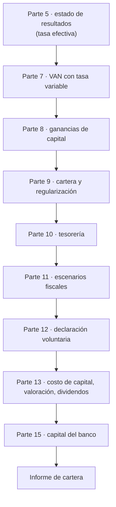

# Ley 21.850: auditoría inicial, mapa curricular e itinerario

Mapa de cómo el caso
[«Ley 21.850: qué cambia en el costo de capital, los dividendos y la liquidez»](../case-studies/chile/ley-21850-reconstruccion-nacional.md)
se reparte en el programa. Igual que el caso de Ueno Bank, **no es una unidad aparte**: vive
dentro de 18 clases que ya existían, cada una con un aspecto distinto, y los hechos comunes están
una sola vez en el expediente. Las soluciones están en la
[guía de ejercicios](ejercicios-ley-21850.md); la ficha normativa, en
[`regulatory/chile/ley-21850.yml`](../regulatory/chile/ley-21850.yml).

El programa es de **banca**, no de contabilidad tributaria. Por eso la integración no enseña la ley
completa: enseña cómo una reforma tributaria cambia las decisiones de un banco y de sus clientes.
Se trabaja lo que toca flujos, costo de capital, valoración, liquidez, cartera y cumplimiento, y se
deja fuera lo ambiental, pesquero, municipal y de educación superior, que la ley también modifica.

## Auditoría inicial

Antes de añadir nada se revisó qué tenía ya el programa, para **no duplicar** y para saber dónde cabe
cada tema. La revisión cubrió los 23 módulos y las 356 clases, el índice
([`SYLLABUS.md`](../SYLLABUS.md)), las fichas de [`regulatory/`](../regulatory/README.md), el
registro de [fuentes](fuentes.md), los casos, los proyectos, las aplicaciones, las pruebas y los generadores.

| Pregunta | Hallazgo | Consecuencia |
|---|---|---|
| ¿Hay contenido sobre impuestos, valoración y costo de capital? | Sí: escudo fiscal y costo de capital (P13 · 5), valoración (P13 · 10), `VAN` (P7 · 8), flujo de caja (P13 · 3), costos e impuestos del inversionista (P8 · 13) | Se amplían esas clases con un bloque, sin crear otras |
| ¿Hay contenido sobre tesorería, cobranza, estrés y cumplimiento? | Sí: P10 · 12, P9 · 15, P11 · 13, P12 · 3 | Los temas de liquidez, regularización, escenarios y declaración voluntaria caben ahí |
| ¿Existe una clase dedicada al impuesto a la renta chileno? | No, y no se crea: el programa no es un curso tributario | El caso se estudia como **efecto** sobre decisiones |
| ¿Hay un caso previo reutilizable? | Ueno Bank y los casos chilenos de finanzas abiertas | Se conserva su patrón de integración y se añaden referencias cruzadas, no duplicados |
| ¿Qué archivos son generados? | Cabeceras, agenda, pie de cada clase; `SYLLABUS.md`, `STATUS.md`, `FILE_INDEX.md`, glosario, libro y sitio; las tablas de `docs/fuentes.md` | No se editan a mano: se regeneran con sus herramientas |
| ¿El contrato YAML de `regulatory/` sirve? | Sí: los once campos obligatorios alcanzan | **No se cambia el contrato** ni el validador |

El número de clases se mantiene en **356**, sin añadir ni renumerar, como en las integraciones anteriores.

## Qué se aprende y dónde

Los once temas del encargo se reparten así. Cada fila indica a quién afecta y dónde se trabaja.

| Tema | Clase principal | Actor privilegiado |
|---|---|---|
| 1. Rebaja del impuesto corporativo y flujos de caja | P13 · 3; P7 · 8; P5 · 11 | Empresa y banco |
| 2. Integración tributaria y dividendos | P13 · 12 | Accionista |
| 3. Costo de capital y valoración | P13 · 5 y 10 | Empresa, inversionista y banco |
| 4. Incentivos a la inversión y la productividad | P13 · 6 | Empresa |
| 5. Crédito por exportación de servicios y contratación | P13 · 14 | Empresa y banco |
| 6. Ganancias de capital | P8 · 13; P13 · 12 | Inversionista y persona natural |
| 7. Invariabilidad y riesgo regulatorio | P13 · 9 | Inversionista y banco |
| 8. Regularización de deudas, liquidez y tesorería | P10 · 12; P9 · 15 | Persona, empresa y tesorero |
| 9. Medidas transitorias | P12 · 3; P13 · 12 | Empresa y entidad financiera |
| 10. Efectos sobre carteras, empresas y entidades | P9 · 13; P15 · 5 | Banco |
| 11. Impacto fiscal y escenarios alternativos | P11 · 13 | Banco y Estado |

## Matriz: clase, objetivo, contenido, actividad, prerrequisito y evidencia

| Clase existente | Objetivo del aspecto | Contenido añadido | Actividad | Prerrequisito | Evidencia |
|---|---|---|---|---|---|
| [P2 · 9 Patrimonio y balance personal](../modules/01-finanzas-personales/classes/09-patrimonio-y-balance-personal.md) | Donar en vida sin confundirlo con un gasto | Rebaja de 50 % del impuesto a las donaciones | Balance antes y después | Patrimonio personal | Balance con límite de 50 % |
| [P5 · 11 Estado de resultados](../modules/04-contabilidad-financiera/classes/11-estado-de-resultados.md) | Separar efecto fiscal y operativo | Tasa efectiva frente a tasa legal | Conciliación de tasas | Estado de resultados | Una conciliación |
| [P7 · 8 Valor actual neto](../modules/06-matematica-financiera-avanzada/classes/08-valor-actual-neto.md) | Usar la tasa de cada año | `VAN` con tasa de impuesto variable | Comparar tasa por año y tasa única | VAN | Dos cálculos |
| [P8 · 13 Costos, impuestos y sesgos](../modules/07-inversiones-y-mercados/classes/13-costos-impuestos-y-sesgos.md) | Rendimiento neto de impuestos | Ganancias de capital del art. 107 | B3 | Rentabilidad | Antes y después |
| [P9 · 13 Crédito comercial y pyme](../modules/08-analisis-y-gestion-de-credito/classes/13-credito-comercial-y-pyme.md) | Segmentar la cartera por régimen | Régimen general, Pro Pyme, exportadoras | Segmentación | Crédito comercial | Tabla de segmentos |
| [P9 · 15 Cobranza y reestructuración](../modules/08-analisis-y-gestion-de-credito/classes/15-cobranza-y-reestructuracion.md) | Coordinar deuda con el Estado y con el banco | Condonación condicional | Plan de coordinación | Reestructuración | Plan |
| [P9 · 12 Crédito hipotecario](../modules/08-analisis-y-gestion-de-credito/classes/12-credito-hipotecario.md) | Financiar sobre beneficios no ejercidos | IVA de vivienda nueva, 5 % al arriendo, territorial 65+ | B7 | Crédito hipotecario | Cuota-ingreso con y sin regla |
| [P10 · 12 Tesorería](../modules/09-operaciones-bancarias/classes/12-tesoreria.md) | Liquidez de los clientes | Facilidades de pago | B5, B6 | Liquidez | Comparación contado/convenio |
| [P11 · 13 Pruebas de estrés](../modules/10-gestion-integral-de-riesgos/classes/13-pruebas-de-estres.md) | Escenarios fiscales | Tres escenarios y estrés inverso | A4 | Estrés | Tabla de escenarios |
| [P12 · 3 Prevención de lavado](../modules/11-regulacion-cumplimiento-y-auditoria/classes/03-prevencion-de-lavado-de-activos.md) | Declaración voluntaria y cruces | Información al SII y la UAF | Protocolo | Debida diligencia | Protocolo |
| [P13 · 3 Flujo de caja](../modules/12-finanzas-corporativas-y-banca-empresarial/classes/03-flujo-de-caja-y-necesidades-de-fondos.md) | Flujo y covenant | Cobertura con tasa por año | B1 | Flujo de caja | Cobertura 2026-2029 |
| [P13 · 5 Costo de capital](../modules/12-finanzas-corporativas-y-banca-empresarial/classes/05-estructura-y-costo-de-capital.md) | Escudo fiscal menor | `WACC` con 27 % y 23 % | Ejemplo guiado 2, A1 | Costo de capital | Sensibilidad de `k_e` |
| [P13 · 6 Decisiones de inversión](../modules/12-finanzas-corporativas-y-banca-empresarial/classes/06-decisiones-de-inversion.md) | Distinguir incentivos | Tasa, invariabilidad y capacitación | Tabla de incentivos | VAN | Tabla |
| [P13 · 9 Financiamiento de proyectos](../modules/12-finanzas-corporativas-y-banca-empresarial/classes/09-financiamiento-de-proyectos.md) | Invariabilidad como seguro | Plazos del art. 26 | A2 | Proyectos | Probabilidad de equilibrio |
| [P13 · 10 Valoración](../modules/12-finanzas-corporativas-y-banca-empresarial/classes/10-valoracion-de-empresas.md) | Revaluar por etapas | Tasa por año | Valoración | Valoración | Dos valoraciones |
| [P13 · 12 Mercado de capitales](../modules/12-finanzas-corporativas-y-banca-empresarial/classes/12-mercado-de-capitales-para-empresas.md) | Dividendos e integración | Carga `t_f × RLI + ρ × IDPC` | Ejemplo guiado 1, B2 | Costo de capital | Tabla de carga |
| [P13 · 14 Relación integral](../modules/12-finanzas-corporativas-y-banca-empresarial/classes/14-relacion-integral-con-la-empresa.md) | Contratar con crédito | Art. 33 ter | B4 | Relación con la empresa | Cálculo del crédito |
| [P15 · 5 Planificación de capital](../modules/14-estrategia-y-direccion-bancaria/classes/05-planificacion-estrategica-y-de-capital.md) | Efecto en el propio banco | Resultado y activo diferido | A3 | Capital | Efecto en el índice |

La progresión sigue la del programa: primero se mide el efecto en cifras elementales (P5, P7, P8),
después en el crédito y la tesorería (P9, P10), luego en el riesgo y la norma (P11, P12), en las
finanzas de la empresa (P13) y, al final, en la dirección del banco (P15).

### Medidas con vigencia 2027-2030 y dónde se trabajan

Una segunda lectura de la ley, centrada en el calendario, encontró medidas que el primer recorrido no había
llevado a las clases. Se incorporaron **dentro de las mismas clases**, no en unidades nuevas.

| Medida | Clase |
|---|---|
| Pagos provisionales: rebaja de enero a marzo de 2027, 2028 y 2029 | P13 · 3 (B8) |
| Pro Pyme: 12,5 % → 15 % → 23 % y el escalón de 2029 | P9 · 13 (B9) |
| Franquicia SENCE de 0,7 % | P13 · 6 (B10) |
| Crédito por enfermedades catastróficas (art. 33 quáter) | P13 · 14 |
| Impuesto único de 5 % al arriendo, IVA de vivienda nueva, territorial 65+ | P9 · 12 (B7) |
| Rebaja del impuesto a las donaciones | P2 · 9 |
| Declaración voluntaria de capitales en el extranjero (2027) | P12 · 3 |
| Plazo del impuesto único sobre FUR y STUT (hasta 2027-06-17) | P13 · 12 (A5) |
| Calendario por año tributario y informes al Congreso | P15 · 5 |

El calendario propio de la Ley 21.713, que la ley modifica, **no se verificó** y queda como pendiente.

## Perspectivas por actor

Una regla simple resume el caso: **el mismo cambio no pesa igual en todos**.

| Actor | Qué cambia | Dónde se ve |
|---|---|---|
| Banco | Su propio impuesto y su activo diferido; la cobertura de su cartera | P15 · 5; P9 · 13; P11 · 13 |
| Empresa no financiera | Impuesto, flujo, costo de contratar y de capital | P13 · 3, 5, 10 y 14 |
| Inversionista | Carga sobre dividendos y exención de ganancias de capital | P13 · 12; P8 · 13 |
| Persona natural | Impuestos finales, regularización con Tesorería y municipalidades | P10 · 12; P9 · 15 |

## Itinerario del estudiante

Cada parada necesita la anterior: quien llegue a la valoración (P13 · 10) sin haber visto el `VAN` con
tasa variable (P7 · 8) no podrá separar el efecto de la ley del de otras variables.

1. Lee el [expediente](../case-studies/chile/ley-21850-reconstruccion-nacional.md) y marca cada
   frase con **[H] [D] [P] [I] [S]**.
2. Recorre las clases en el orden de la matriz y guarda la evidencia en `portfolio/parte-N/clase-M/`.
3. Resuelve los ejercicios de la [guía](ejercicios-ley-21850.md) según tu nivel (B1 a B6 en
   Analista y Bancario; A1 a A5 desde Bancario).
4. Entrega el informe de cartera (Parte D de la guía) y autoevalúate con la rúbrica.
5. Aplica el método a otra reforma, por ejemplo la [Ley 21.521](mapa-regulatorio-chile.md).

## Recorrido del docente

| Momento | Qué hacer |
|---|---|
| Antes del curso | Confirmar en la BCN la versión vigente del texto y buscar las instrucciones del SII; actualizar la fecha de corte |
| En cada clase | Presentar el aspecto con el bloque «Conexión con un caso» y pedir la evidencia |
| En la Parte 13 | Conducir el ejemplo guiado 2 y el ejercicio A1 |
| En la Parte 11 | Dirigir los escenarios fiscales |
| Al evaluar | Aplicar la ponderación 20-30-30-20 de la guía |

**Reglas de aula.** No dar asesoría tributaria; mostrar siempre la etiqueta de nivel; declarar qué
instrucciones del SII se desconocen; y no tratar un resumen de un estudio jurídico como si fuera el texto.

## Instrumentos pendientes

La ley manda dictar instrumentos administrativos. **Ninguno se dio por existente.** Al 2026-11-05 el
programa los registra como pendientes, a la espera de poder consultarlos en la fuente oficial.

| Instrumento | Autoridad | Estado |
|---|---|---|
| Instrucciones sobre el registro SAC y la restitución decreciente | SII | Pendiente: el SII anunció (2026-10-19) 13 circulares y 17 resoluciones; ninguna se pudo confirmar como dictada |
| Formulario de opción del impuesto único sobre FUR, STUT y retiros en exceso | SII | Pendiente |
| Registro de trabajadores del art. 33 ter | SII | Pendiente |
| Catálogo de servicios del conocimiento | Hacienda y Economía | Pendiente |
| Normas de información de empresas receptoras de inversión | CMF | Pendiente; plazo de seis meses desde la publicación |
| Reglamentos del contrato de inversión y de reorganizaciones | Hacienda | Pendiente |

En esta integración **no se consultaron** los sitios de la CMF, la Tesorería ni el SENCE: la ley se leyó en la BCN y la
búsqueda de instrumentos administrativos quedó pendiente, no concluida.

## Verificación y límites

La integración se verificó con los validadores del repositorio y con la recalculación de las cifras
(`tests/test_ley_21850_ejercicios.py`). El texto de la ley se contrastó con el formato de intercambio
de la BCN; dos afirmaciones de una firma de auditoría (recargo de invariabilidad y límite de deuda
relacionada) **no se localizaron** en el texto consultado y quedan marcadas **[D]**. La revisión
conceptual y pedagógica es una lectura humana que ninguna herramienta sustituye.
