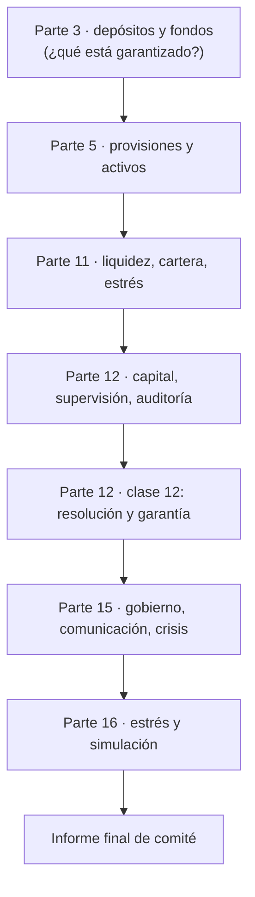

# Ueno Bank Paraguay: matriz de integración e itinerario

Mapa de cómo el caso
[«Ueno Bank Paraguay: aprender sobre solvencia, riesgos, gobierno corporativo y
resolución bancaria»](../case-studies/bank-resolution/ueno-bank-paraguay.md) se reparte
en las clases del programa. El caso no es una unidad aparte: **vive dentro de las clases
que ya existían**, cada una con un aspecto distinto, y los hechos comunes están una sola
vez en el expediente. Las soluciones están en la
[guía de ejercicios](ejercicios-ueno-bank.md).

Se trata de un caso real **en desarrollo** (fecha de corte 2026-11-04). Las clases no
repiten el relato: lo usan como material para un concepto concreto, con el expediente como
referencia y con la etiqueta de nivel de cada dato.

## Qué se aprende y dónde

El cuadro siguiente recoge las siete competencias que persigue la integración, el nivel
al que se introduce cada una y la clase donde se trabaja. Se lee de arriba abajo en el
orden recomendado: cada fila presupone las anteriores.

| Competencia | Etapa y nivel | Clase principal |
|---|---|---|
| Distinguir liquidez, solvencia y rentabilidad con sus propias palabras | Analista · Bancario | Parte 11, clase 4 |
| Explicar cómo un problema de cartera afecta el balance y el capital | Analista · Bancario | Parte 5, clase 13; Parte 11, clases 3 y 13; Parte 12, clase 6 |
| Reconocer concentración y operaciones con partes relacionadas | Bancario | Parte 11, clase 3; Parte 15, clase 9 |
| Comprender las funciones del directorio, la auditoría y el supervisor | Bancario · Dirección | Parte 12, clases 13 y 15; Parte 15, clase 9 |
| Diferenciar recuperación, resolución, liquidación y garantía de depósitos | Bancario | Parte 12, clase 12 |
| Interpretar las consecuencias para depositantes, empresas y servicios de pago | Fundamentos · Bancario | Parte 3, clases 10 y 11; Parte 12, clase 12; Parte 15, clase 13 |
| Justificar decisiones con datos, fuentes y supuestos explícitos | Dirección | Parte 11, clase 16; Parte 15, clase 12; Parte 16, clases 15 y 17 |

## Matriz: clase, objetivo, contenido, actividad, prerrequisito y evidencia

La matriz es la tabla central de la integración. Cada fila es una clase existente y trabaja
**un solo aspecto** del caso; el prerrequisito indica qué debe haberse visto antes y la
evidencia es lo que el estudiante deja en su portafolio.

| Clase existente | Objetivo del aspecto | Contenido añadido | Actividad | Prerrequisito | Evidencia |
|---|---|---|---|---|---|
| [P3 · 10 Depósitos a plazo](../modules/02-productos-y-servicios-financieros/classes/10-depositos-a-plazo.md) | Entender que la garantía es por depositante | Conexión breve con el tope de Gs 228,3 M | Frase sobre dos cuentas en la misma entidad | Cuentas y ahorro | Una frase |
| [P3 · 11 Fondos y ahorro previsional](../modules/02-productos-y-servicios-financieros/classes/11-fondos-y-ahorro-previsional.md) | Distinguir depósito y fondo mutuo | Suspensión de rescates; patrimonio separado | Frase comparativa | Depósitos a plazo | Una frase |
| [P5 · 3 Activos](../modules/04-contabilidad-financiera/classes/03-activos.md) | Cuándo un gasto se activa | Activación de software sin respaldo | Condiciones de activación | Ecuación contable | Una frase |
| [P5 · 13 Depreciaciones y provisiones](../modules/04-contabilidad-financiera/classes/13-depreciaciones-y-provisiones.md) | Efecto de una provisión sobre el patrimonio | Provisión de 60 sobre un banco sintético | Asiento | Patrimonio; activos | Asiento |
| [P11 · 3 Riesgo de crédito de cartera](../modules/10-gestion-integral-de-riesgos/classes/03-riesgo-de-credito-de-cartera.md) | Concentración por grupo y partes relacionadas | Vinculadas, HHI por nombre y por grupo | B4, A3 | P5 · 13 | Dos columnas con HHI |
| [P11 · 4 Riesgo de liquidez](../modules/10-gestion-integral-de-riesgos/classes/04-riesgo-de-liquidez.md) | Liquidez frente a solvencia | Retiro frente a pérdida; cobertura | Ejemplo guiado 1, B1, I3 | P5 · 10 | Tabla de eventos |
| [P11 · 13 Pruebas de estrés](../modules/10-gestion-integral-de-riesgos/classes/13-pruebas-de-estres.md) | Estrés inverso y sensibilidad a un supuesto | Umbrales con `APR` constante y variable | A2, A4 | P11 · 3 y 4 | Tabla de umbrales |
| [P11 · 16 Comité de riesgos](../modules/10-gestion-integral-de-riesgos/classes/16-comite-de-riesgos-e-integracion.md) | Decidir en conjunto | Actividad integradora | Parte D de la guía | P11 · 3, 4 y 13 | Informe de comité |
| [P12 · 6 Capital regulatorio](../modules/11-regulacion-cumplimiento-y-auditoria/classes/06-capital-regulatorio-pilar-1.md) | Patrimonio frente a capital; «porcentaje del mínimo» | Índice, deducción, capital anunciado e integrado | Ejemplo guiado 2, B2, I1, I2 | P11 · 3 | Cadena provisión → índice |
| [P12 · 13 Supervisión bancaria](../modules/11-regulacion-cumplimiento-y-auditoria/classes/13-supervision-bancaria.md) | Calendario del supervisor | Cronología del 5 de junio al 2 de noviembre | Información que falta | P12 · 7 | Línea de tiempo |
| [P12 · 15 Auditoría externa](../modules/11-regulacion-cumplimiento-y-auditoria/classes/15-auditoria-externa-y-control-interno.md) | Evidencia contable de provisiones y activaciones | Carpetas débiles; activación sin respaldo | Preguntas de auditoría | P5 · 3 y 13 | Tres preguntas |
| [P12 · 12 Resolución y seguro de depósitos](../modules/11-regulacion-cumplimiento-y-auditoria/classes/12-resolucion-bancaria-y-seguro-de-depositos.md) | Resolución, garantía y consecuencias | Hechos del 2 al 4 de noviembre; garantía; anticipo; fondos mutuos | B3, I4, A1 | P12 · 6 y 13 | Cálculo de pago y comparación de alternativas |
| [P15 · 5 Planificación de capital](../modules/14-estrategia-y-direccion-bancaria/classes/05-planificacion-estrategica-y-de-capital.md) | Calendario del capital | Capitalización anunciada frente a integrada | I1 | P12 · 6 | Plan de capital |
| [P15 · 9 Gobierno corporativo](../modules/14-estrategia-y-direccion-bancaria/classes/09-gobierno-corporativo.md) | Control de partes relacionadas | Mecanismos y preguntas | Tabla de control | P11 · 3 | Tabla completada |
| [P15 · 12 Comunicación y mercado](../modules/14-estrategia-y-direccion-bancaria/classes/12-comunicacion-y-mercado.md) | Comunicar sin confundir | Tope, anticipo y saldo | Comunicado de 120 palabras | P12 · 12 | Comunicado |
| [P15 · 13 Gestión de crisis](../modules/14-estrategia-y-direccion-bancaria/classes/13-gestion-de-crisis.md) | Secuencia de decisiones | Primeras 72 horas | Ordenar medidas | P12 · 12 | Orden y justificación |
| [P16 · 15 Prueba de estrés del banco](../modules/15-proyecto-banco-virtual/classes/15-prueba-de-estres-del-banco.md) | Estrés inverso en el proyecto | Tabla por hipótesis | A2, A4 con datos propios | P11 · 13 | Tabla del Banco Virtual |
| [P16 · 17 Simulación de una crisis](../modules/15-proyecto-banco-virtual/classes/17-simulacion-de-una-crisis.md) | Simular la resolución | Tres turnos | A1, I4, comunicado | P12 · 12; P15 · 13 | Decisiones e incertidumbres |

La matriz muestra que la progresión sigue la del programa: el caso se estudia primero con
conceptos elementales (P3, P5), después con herramientas de riesgo (P11), con la norma (P12),
con la dirección (P15) y finalmente con la simulación del proyecto (P16). Ninguna clase
reexplica los hechos del caso: los toma del expediente.

## Recorrido del estudiante

El itinerario siguiente no exige estudiar el caso de golpe: cada parada es un bloque de
unos diez minutos dentro de la clase habitual.

El diagrama es una secuencia de prerrequisitos: cada parada necesita la anterior. El estudiante
que llegue a la clase 12 de la Parte 12 sin haber pasado por la 6 encontrará el comunicado,
pero no podrá leer «50 % del mínimo»; por eso la clase 12 remite a la 6 y la 13.

1. Lee el [expediente](../case-studies/bank-resolution/ueno-bank-paraguay.md) y marca cada
   frase con **[H] [D] [P] [I] [S]**.
2. Sigue las clases en el orden de la matriz; en cada una resuelve el bloque «Caso en
   desarrollo» y guarda la evidencia en `portfolio/parte-N/clase-M/`.
3. Resuelve los doce ejercicios de la [guía](ejercicios-ueno-bank.md) según tu nivel
   (básicos si estás en Fundamentos o Analista; intermedios y avanzados desde Bancario).
4. Entrega el informe de comité (Parte D) y autoevalúate con la rúbrica.
5. Aplica el método a otro caso del [catálogo](../case-studies/README.md) (por ejemplo,
   [FTX/Alameda](../case-studies/custody/ftx-alameda.md)): ¿qué parte del caso es hecho, cuál
   declaración, cuál investigación abierta?

## Recorrido del docente

El material cabe en las clases de 90 minutos sin ampliarlas: cada bloque ocupa unos diez
minutos del tramo de práctica y sustituye a un ejercicio de laboratorio, que pasa a práctica
adicional.

| Momento | Qué hacer |
|---|---|
| Antes del curso | Leer el expediente y confirmar si hay nuevos comunicados; actualizar la fecha de corte |
| En cada clase | Presentar el aspecto con la tabla del bloque y pedir la evidencia |
| En la clase 12 de la Parte 12 | Conducir los ejercicios B3, I4 y A1; contrastar la jerarquía de absorción con la ley local |
| En la Parte 16 | Dirigir la simulación de tres turnos |
| Al evaluar | Aplicar la ponderación 20-30-30-20 y los descriptores de la guía de ejercicios |

**Reglas de aula.** Hablar de «se investiga» y «se atribuye», no de «culpable»; no deducir causas
técnicas; mostrar siempre la etiqueta de nivel; y declarar qué parte del caso puede haber
cambiado desde la fecha de corte.

## Aplicar lo aprendido a otro caso

La competencia final es transferir. Con cualquier caso bancario, el estudiante debe poder
responder cinco preguntas que el expediente de Ueno modela: qué es hecho y qué declaración;
si el problema es de liquidez, de solvencia o de ambos; qué mide el índice citado frente al
mínimo; qué cubre la garantía y qué no; y qué sigue pendiente. Quien las responda para un caso
nuevo con fuentes y supuestos explícitos ha logrado el objetivo de la integración.

## Verificación y límites

La integración se verificó con las validaciones estructurales del repositorio y con la
recalculación de las cifras (`tests/test_ueno_bank_ejercicios.py`). La revisión conceptual y
pedagógica —si los ejemplos enseñan lo que dicen enseñar y si la carga es adecuada— es una
lectura humana que ninguna herramienta sustituye. Los hechos del caso se contrastaron con
prensa que reproduce los comunicados del BCP, porque el sitio oficial no respondió a la lectura
automática; queda como pendiente el contraste literal.
