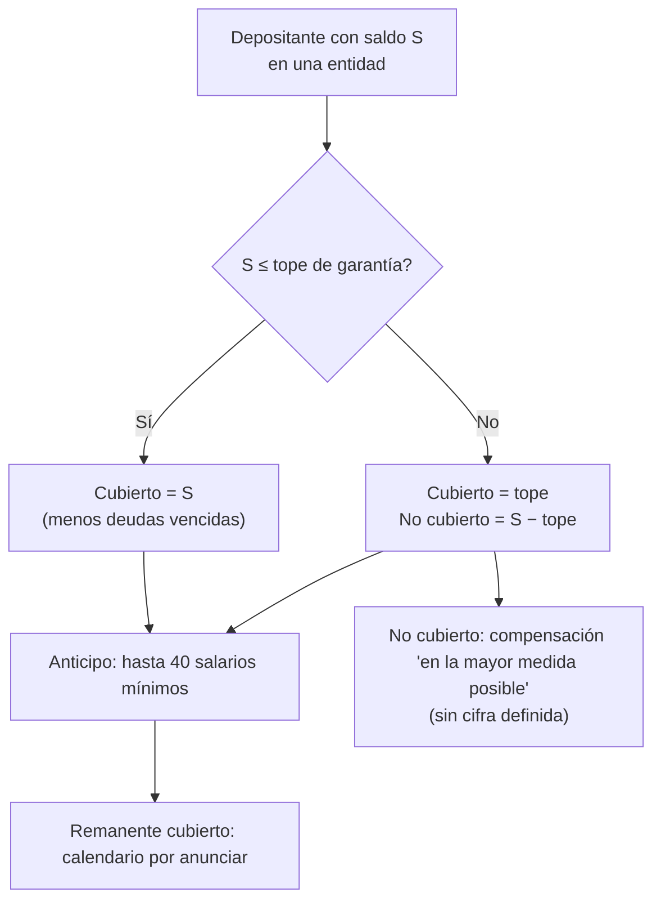

<!-- meta
part: 12
class: 12
title: "Resolución bancaria y seguro de depósitos"
level: profesional
duration_minutes: 90
status: complete
-->

<!-- gen:header:start -->
# Clase 12 · Resolución bancaria y seguro de depósitos

> [← 11 · Disciplina de mercado: Pilar 3](11-disciplina-de-mercado-pilar-3.md) · [Índice de la parte](../README.md) · [13 · Supervisión bancaria →](13-supervision-bancaria.md)

**Parte 12 — Regulación, cumplimiento y auditoría** · **Nivel:** Profesional — perfil bancario · **Duración:** 90 minutos
<!-- gen:header:end -->

## 🎯 Propósito

Entender qué ocurre cuando un banco falla. La respuesta ha cambiado radicalmente: el objetivo ya no es
evitar toda quiebra, sino **permitir que un banco quiebre sin arrastrar al sistema ni al contribuyente**.
Esta clase estudia los instrumentos que hacen eso posible y por qué siguen siendo difíciles de aplicar.

Todas las clases anteriores previenen la quiebra de un banco. Esta trata de qué hacer cuando ocurre igualmente, y su premisa es la lección de 2008: un banco tiene que poder quebrar sin que quiebre el sistema y sin dinero público. Todo el aparato de esta clase existe para hacer posible esa frase.

## 📚 Objetivos

Al finalizar podrás:

1. **Explicar** el problema de las entidades demasiado grandes para quebrar.
2. **Describir** los instrumentos de resolución y cuándo se aplica cada uno.
3. **Calcular** la jerarquía de absorción de pérdidas en una resolución.
4. **Explicar** el funcionamiento y los límites del seguro de depósitos.
5. **Evaluar** un plan de resolución y sus impedimentos.

<!-- gen:agenda:start -->
## Agenda de 90 minutos

La clase dura noventa minutos y se recorre en cinco tramos. No es un horario
rígido: es el orden en que los bloques de esta página se sostienen unos a otros, y
por eso conviene respetarlo aunque cambien los tiempos.

Los **diez primeros minutos** se dedican a recuperar la clase anterior, porque casi
todo lo que aquí se explica supone algo que ya se vio. Los **veinticinco
siguientes** desarrollan los conceptos con la fuente oficial a la vista: las
referencias del final de la página no son un adorno bibliográfico, se consultan
mientras se estudia. Del **minuto 35 al 55** se resuelve el ejemplo guiado paso a
paso, sin saltarse ninguno, porque el error típico vive precisamente en el paso que
parece obvio. Los **veinticinco minutos siguientes** son de práctica con datos
propios o sintéticos —nunca reales de terceros—, que es cuando se comprueba si se
entendió. Los **diez últimos** cierran con las preguntas de comprobación y el
registro del entregable.

Si el tiempo aprieta, lo que se recorta es la práctica y se traslada al
laboratorio de la parte; lo que no se recorta nunca es el ejemplo guiado.
<!-- gen:agenda:end -->

## 🧩 Conceptos centrales

Los cuatro primeros términos son el momento y el mecanismo; los cuatro siguientes, los instrumentos y su garantía. El **principio de no perjuicio** es la restricción que ordena todo: ningún acreedor puede quedar peor en la resolución de lo que habría quedado en una liquidación ordinaria.

| Concepto | Comprensión verificable |
|---|---|
| `resolución` | Reestructuración ordenada de un banco inviable, fuera del concurso ordinario. |
| `punto de inviabilidad` | Momento en que la autoridad declara que el banco no es viable. |
| `absorción interna de pérdidas` | Que accionistas y acreedores absorban, no el Estado. |
| `capacidad total de absorción` | Instrumentos disponibles para absorber pérdidas y recapitalizar. |
| `banco puente` | Entidad temporal que recibe las funciones críticas. |
| `funciones críticas` | Actividades cuya interrupción dañaría la economía real. |
| `plan de resolución` | Documento que describe cómo se resolvería la entidad. |
| `principio de no perjuicio` | Ningún acreedor puede quedar peor que en una liquidación ordinaria. |
| `interventor` | Agente que la autoridad designa para verificar la situación patrimonial y preservar los activos durante la resolución. |
| `balance de exclusión` | Corte que separa los activos y pasivos que se transfieren de los que quedan en la entidad resuelta. |
| `anticipo de garantía` | Primer desembolso de la garantía, que es una fracción del total cubierto y no el total. |
| `subrogación` | Derecho del fondo a ocupar el lugar del depositante frente al banco por lo que ya pagó. |

## 🧠 Modelo mental

El modelo mental es una escalera de absorción: las pérdidas las absorbe primero el accionista, después los tenedores de instrumentos diseñados para absorberlas, después los acreedores no garantizados y solo al final, si acaso, un fondo. El orden es previo y conocido, y esa previsibilidad es lo que evita el pánico.

```text
EL PROBLEMA QUE HABÍA QUE RESOLVER

  banco grande en problemas → dos opciones malas
    liquidarlo:  interrumpe pagos, crédito y depósitos
                 → daño sistémico
    rescatarlo:  el contribuyente paga
                 → riesgo moral: el siguiente banco toma más riesgo

LA TERCERA VÍA: RESOLUCIÓN
  las funciones críticas CONTINÚAN
  las pérdidas las absorben accionistas y acreedores
  el banco como entidad puede desaparecer
  el servicio no se interrumpe
```

**La resolución separa dos cosas que la quiebra ordinaria confunde:** la continuidad del servicio y la
supervivencia de la entidad. El objetivo es preservar la primera y permitir que la segunda termine.

## 📖 Desarrollo

### 1. Condiciones para resolver

Resolver un banco exige condiciones que se comprueban y se declaran. La tabla las recoge.

```text
TRES CONDICIONES CONCURRENTES
  1. la entidad es inviable o es previsible que lo sea
  2. no existe una alternativa privada oportuna
     (aumento de capital, venta, acuerdo con acreedores)
  3. la resolución es necesaria para el interés público
     (continuidad de funciones críticas, estabilidad,
      protección de depositantes o de fondos públicos)

si falta la tercera, el banco va a liquidación ordinaria
```

```text
PUNTO DE INVIABILIDAD
  es una DECISIÓN de la autoridad, no un umbral automático
  puede declararse antes de que el capital sea negativo

  esa anticipación es deliberada:
  esperar a la insolvencia contable destruye valor
  y reduce las opciones disponibles
```

### 2. Instrumentos

La autoridad dispone de varios instrumentos con efectos distintos. La tabla los recoge.

| Instrumento | Qué hace | Cuándo se prefiere |
|---|---|---|
| Venta del negocio | Transfiere la entidad o parte a un comprador | Hay comprador y tiempo |
| Banco puente | Entidad temporal pública recibe lo viable | No hay comprador inmediato |
| Segregación de activos | Transfiere activos deteriorados a un vehículo | Cartera problemática identificable |
| Absorción interna de pérdidas | Reduce o convierte deuda en capital | Entidad grande, funciones críticas |

En la práctica esos instrumentos no se usan por separado: la resolución de una
entidad mediana suele combinar tres de ellos.

```text
COMBINACIÓN HABITUAL
  absorción interna para recapitalizar
  + segregación de activos deteriorados
  + venta posterior de la entidad recapitalizada
```

### 3. Jerarquía de absorción

La jerarquía es previa y determina quién pierde primero. El esquema la recoge.

```text
ORDEN DE ABSORCIÓN (de primero a último)

  1. CAPITAL NIVEL 1 ORDINARIO          accionistas
  2. CAPITAL NIVEL 1 ADICIONAL          instrumentos AT1
  3. CAPITAL NIVEL 2                    subordinados
  4. OTRA DEUDA SUBORDINADA
  5. DEUDA SÉNIOR NO PREFERENTE         emitida para absorber
  6. DEUDA SÉNIOR PREFERENTE
  7. DEPÓSITOS DE EMPRESAS GRANDES      no cubiertos
  8. DEPÓSITOS DE PERSONAS Y PYMES      la parte no cubierta
  9. DEPÓSITOS CUBIERTOS                → los asume el fondo de garantía;
                                          el depositante NO pierde
```

```text
PRINCIPIO DE NO PERJUICIO
  ningún acreedor puede recibir menos
  de lo que habría recibido en una liquidación ordinaria

  si ocurre, se le compensa con cargo al fondo de resolución
  → este principio es la garantía jurídica de todo el sistema
    y la fuente de la mayor parte de los litigios
```

### 4. Capacidad de absorción

El banco tiene que mantener una cantidad de pasivos capaces de absorber pérdidas. El procedimiento la calcula.

```text
LA RESOLUCIÓN SOLO FUNCIONA SI HAY QUÉ ABSORBER

  requerimiento de capacidad total de absorción (entidades sistémicas)
  y su equivalente para otras entidades

  la deuda computable debe:
    · estar subordinada a los pasivos operativos
    · tener plazo residual suficiente
    · no estar garantizada
    · no estar en manos de depositantes minoristas
      → este último punto es crítico
```

**Por qué importa quién tiene la deuda.** Si los instrumentos de absorción fueron colocados a clientes
minoristas del propio banco, aplicarles pérdidas es política y jurídicamente muy difícil. Ha ocurrido, y
la respuesta normativa fue prohibir o restringir esa colocación: **la absorción de pérdidas solo es
creíble si quien las absorbe pudo evaluarlas**.

### 5. Seguro de depósitos

El seguro protege a los depositantes pequeños y con eso evita que la corrida empiece. La tabla recoge su alcance y sus límites.

```text
FUNCIÓN
  · proteger al pequeño depositante
  · evitar la corrida: si el depósito está garantizado,
    no hay razón para correr

DISEÑO
  cobertura por depositante y por entidad, con un límite
  financiamiento previo por aportes de los bancos
  pago rápido: pocos días hábiles
  cobertura de depósitos, no de inversiones
```

| Elemento | Efecto |
|---|---|
| Límite de cobertura | Sobre él, el depositante vigila; bajo él, no |
| Pago rápido | Evita la corrida por iliquidez del depositante |
| Financiamiento previo | El fondo existe antes de necesitarse |
| Prima ajustada por riesgo | Reduce el riesgo moral entre bancos |
| Preferencia del depositante | Mejora la recuperación del fondo |

El diseno del seguro se completa con lo que deja fuera, y ahi esta el origen
de una confusión que cuesta cara al cliente.

```text
LO QUE EL SEGURO NO CUBRE
  · fondos mutuos, acciones, bonos adquiridos a través del banco
  · depósitos de otras entidades financieras
  · saldos por encima del límite
  · en general, instrumentos de inversión

la confusión entre depósito e inversión
es una fuente recurrente de daño al cliente
```

### Caso en desarrollo · Ueno Bank Paraguay: resolución, garantía y consecuencias para depositantes

Hasta aquí la clase ha descrito los instrumentos de resolución y el seguro de depósitos en
abstracto. El caso de ueno bank permite verlos operar en una jurisdicción concreta mientras el
desenlace sigue abierto (**fecha de corte 4 de noviembre de 2026**). Recuérdese del tramo anterior
de la Parte 12 el índice de solvencia (clase 6) y la supervisión (clase 13); sin ellos el comunicado
no se entiende.

**Lo documentado.** El Directorio del BCP resolvió el 2 de noviembre iniciar el procedimiento de
resolución, al amparo de la Ley N.º 2.334/03; el índice de solvencia quedó por debajo del 50 % del
mínimo tras ajustes a los estados financieros; la Superintendencia designa interventores; la
garantía cubre **hasta 75 salarios mínimos por depositante y por entidad** (Gs 228.300.000 «a la
fecha»); el 4 de noviembre se anunció un **anticipo** de hasta 40 salarios mínimos, descontando
deudas vencidas **[comunicados del BCP, vía prensa]**. Los instrumentos precisos de la ley no
se detallan en esos comunicados, y este expediente no afirma el contenido de ningún artículo.

Cuatro distinciones separan una lectura correcta de una errónea. Una **resolución** no es una
liquidación: busca que las funciones críticas continúen mientras la entidad termina. La
**garantía** es por depositante y por entidad, no por cuenta: tres cuentas en el mismo banco
suman antes del tope. El **anticipo** (primer desembolso) no equivale al total cubierto: 40 de
75 salarios es el 53,3 %. Y el **saldo cubierto** no es el **saldo depositado**: un depositante
con Gs 400 millones tiene cubierto el 57,1 % y no cubierto el 42,9 %.



El diagrama recorre la decisión que toma el fondo con cada depositante. Lo que hay que mirar
es que **hay tres cantidades** en el camino (anticipo, remanente cubierto, no cubierto), y que
la última no tiene regla numérica en las fuentes leídas. La **jerarquía de absorción** de esta
clase gobernaría quién pierde primero; en Paraguay, la prelación aplicable se verifica en la
ley, y **los instrumentos y límites de resolución dependen de la jurisdicción**.

**Ejemplo guiado profesional.** El ejercicio A1 de la guía compara cuatro alternativas con el
banco sintético (liquidación y pago directo; venta total; transferencia de cubiertos con los
mejores activos; transferencia con activos proporcionales) y aplica el principio de no perjuicio
y una regla de menor costo: solo la cuarta cumple ambas y mantiene el servicio. El ejercicio I4
calcula anticipo, remanente y no cubierto para tres depositantes.

**Consecuencias.** Para el depositante pequeño, la garantía protege su depósito; la incertidumbre
es de *tiempo*. Para el depositante grande y las empresas, la incertidumbre es de *monto* y de
tiempo. Los servicios de pago se acotan con medidas concretas (alias liberados en el SIP el 4
de noviembre). Los **fondos mutuos** vinculados no están garantizados: son patrimonios separados
y la Superintendencia de Valores suspendió temporalmente los rescates **[hechos comunicados]**.
**Pendiente:** balance de exclusión, déficit, entidades receptoras y calendario de pagos.

**Práctica con el caso.** Resuelve B3, I4 y A1 de la guía y escribe, en cinco líneas, qué diría
un comunicado claro a un depositante con Gs 400 millones.
Este bloque ocupa unos diez minutos del tramo de práctica (55–80) y sustituye a uno de los ejercicios del laboratorio, que queda como práctica adicional.

**Para seguir.** El expediente del caso está en [Ueno Bank Paraguay](../../../case-studies/bank-resolution/ueno-bank-paraguay.md), con cada dato etiquetado como hecho, declaración, pendiente, interpretación o supuesto; las soluciones, en [la guía de ejercicios](../../../docs/ejercicios-ueno-bank.md); y el lugar de esta clase en el recorrido, en la [matriz](../../../docs/ueno-bank-matriz-e-itinerario.md). Aquí solo se trabaja la resolución, la garantía y sus consecuencias.

## 🧮 Ejemplo guiado

El ejemplo aplica la jerarquía de absorción a un banco en resolución. Conviene comprobar el principio de no perjuicio al final: es lo que hace impugnable una resolución.

**Situación.** La autoridad debe resolver un banco mediano.

```text
BALANCE AL PUNTO DE INVIABILIDAD (valores estimados de mercado)
  ACTIVOS
    cartera de crédito, valor razonable          1 840 000
    inversiones                                    286 000
    otros activos                                  124 000
    TOTAL ACTIVOS                                2 250 000

  PASIVOS
    depósitos cubiertos por el seguro              940 000
    depósitos de personas y pymes, no cubiertos    218 000
    depósitos de empresas grandes                  386 000
    deuda sénior preferente                        294 000
    deuda sénior no preferente                     180 000
    capital nivel 2                                 96 000
    capital nivel 1 adicional                       64 000
    TOTAL PASIVOS                                2 178 000

  PATRIMONIO CONTABLE DECLARADO                     138 000
  PATRIMONIO A VALOR RAZONABLE                       72 000

FUNCIONES CRÍTICAS
  cuentas de 1,4 millones de personas
  nómina de 6 800 empresas
  4,2 % del crédito a pequeñas empresas del país
```

**Paso 1 — determina la pérdida a absorber.**

```text
el deterioro ya reconocido llevó el patrimonio
de 138 000 (contable) a 72 000 (valor razonable)

la valoración independiente para la resolución estima
un deterioro adicional de la cartera de 214 000

PATRIMONIO TRAS LA VALORACIÓN: 72 000 − 214 000 = −142 000

PÉRDIDA A ABSORBER: 214 000
CAPITAL A REPONER para que la entidad sea viable
(objetivo: CET1 del 11 % sobre activos ponderados de 1 420 000):
  156 200
NECESIDAD TOTAL: 214 000 + 156 200 = 370 200
```

**Paso 2 — aplica la jerarquía.**

```text
1. CAPITAL NIVEL 1 ORDINARIO
   72 000 (valor razonable) → absorbido íntegramente
   accionistas: pérdida total
   ACUMULADO ABSORBIDO: 72 000

2. CAPITAL NIVEL 1 ADICIONAL
   64 000 → absorbido íntegramente
   ACUMULADO: 136 000

3. CAPITAL NIVEL 2
   96 000 → absorbido íntegramente
   ACUMULADO: 232 000

4. DEUDA SÉNIOR NO PREFERENTE
   180 000
   necesidad restante: 370 200 − 232 000 = 138 200
   → se absorben 138 200 de los 180 000  (76,8 %)
   ACUMULADO: 370 200  ✓ necesidad cubierta
```

**Paso 3 — verifica quién NO absorbe.**

```text
NO ABSORBEN
  · el remanente de deuda sénior no preferente: 41 800
  · la deuda sénior preferente: 294 000
  · los depósitos de empresas grandes: 386 000
  · los depósitos no cubiertos de personas y pymes: 218 000
  · los depósitos cubiertos: 940 000

la resolución se detiene en el escalón 5
sin tocar ningún depósito
```

**Paso 4 — aplica el principio de no perjuicio.**

```text
¿QUÉ HABRÍAN RECIBIDO EN LIQUIDACIÓN ORDINARIA?

valoración de liquidación (venta forzada, con descuento adicional):
  activos realizables: 1 940 000  (frente a 2 036 000 en resolución)

reparto según prelación de la liquidación:
  depósitos cubiertos (preferentes)      940 000  → 100 %
  depósitos de personas y pymes          218 000  → 100 %
  depósitos de empresas                  386 000  → 100 %
  sénior preferente                      294 000  →  34,7 % (102 000)
  sénior no preferente                          →   0 %
  capital nivel 2, AT1, acciones                →   0 %

COMPARACIÓN PARA LA DEUDA SÉNIOR PREFERENTE
  en liquidación:  34,7 %
  en resolución:   100 %
  → mejor en resolución  ✓

COMPARACIÓN PARA LA SÉNIOR NO PREFERENTE
  en liquidación:  0 %
  en resolución:   23,2 % (41 800 de 180 000)
  → mejor en resolución  ✓

NINGÚN ACREEDOR QUEDA PEOR: el principio se cumple
```

**Paso 5 — elige el instrumento.**

```text
¿HAY COMPRADOR?
  se consultó a tres entidades en el fin de semana previo
  ninguna acepta la entidad completa
  una acepta la red de sucursales y los depósitos,
  sin la cartera de empresas deteriorada

DECISIÓN: combinación
  · absorción interna de pérdidas para recapitalizar (370 200)
  · segregación de la cartera deteriorada a un vehículo (168 000)
  · venta de la entidad recapitalizada al comprador interesado
```

**Paso 6 — verifica la continuidad de las funciones críticas.**

```text
· las cuentas de 1,4 millones de personas: sin interrupción
  (los depósitos no se tocan; la entidad sigue operando)
· la nómina de 6 800 empresas: sin interrupción
· el crédito a pequeñas empresas: continúa en la entidad recapitalizada

REQUISITOS OPERATIVOS PARA QUE ESTO FUNCIONE
  · los sistemas deben seguir operando durante el fin de semana
  · los contratos con proveedores críticos no deben poder
    terminarse por la resolución misma
  · el personal clave debe permanecer
  · debe existir información de depositantes lista para el fondo

estos requisitos se preparan AÑOS ANTES,
en el plan de resolución
```

**Paso 7 — identifica qué habría impedido la resolución.**

```text
IMPEDIMENTOS QUE SE EVITARON GRACIAS A LA PREPARACIÓN
  · si la deuda sénior no preferente hubiera estado
    en manos de clientes minoristas del banco:
    aplicar 138 200 de pérdidas habría sido inviable
    en la práctica → la resolución habría requerido fondos públicos

  · si los contratos con el proveedor del núcleo bancario
    hubieran permitido su terminación por resolución:
    el sistema se habría detenido el lunes

  · si no existiera un registro consolidado de depositantes
    por persona: el fondo no habría podido pagar en días

  · si las funciones críticas estuvieran distribuidas
    entre entidades del grupo sin separabilidad:
    no se habría podido vender solo la parte viable
```

**Interpreta:** la resolución funcionó porque **las condiciones se prepararon antes de necesitarse**. La
absorción de 370 200 sin tocar un solo depósito fue posible porque existían 340 000 de instrumentos
diseñados para absorber, colocados entre inversionistas que podían evaluarlos. Un banco sin esa
estructura de pasivos no es resoluble, y en ese caso las únicas opciones vuelven a ser las dos malas del
principio.

## 🏦 Del cliente al banco

El depositante confía en la garantía y el banco mantiene una capacidad de absorción que le cuesta dinero. La tabla enfrenta las dos lecturas.

| Vista del cliente | Vista del banco | Parte |
|---|---|---|
| «¿Mi depósito está garantizado?» | Cobertura y su límite | 4, clase 11 |
| «Compré un bono del banco y perdí todo» | Absorción interna de pérdidas | 12, clase 12 |
| «El banco cambió de dueño de un día para otro» | Venta del negocio en resolución | 12, clase 12 |
| «Pude seguir usando mi cuenta» | Continuidad de funciones críticas | 12, clase 12 |
| «Rescataron a los bancos con impuestos» | El objetivo del marco es evitarlo | 12, clase 1 |

## 🧪 Práctica

El laboratorio pide aplicar la jerarquía y comprobar el principio de no perjuicio. Un acreedor queda peor que en liquidación, y detectarlo es el objetivo.

En `labs/lab-06.md`, sección de resolución:

1. Aplica la jerarquía de absorción a un balance en punto de inviabilidad.
2. Verifica el principio de no perjuicio comparando con una liquidación.
3. Elige el instrumento de resolución adecuado y justifícalo.
4. Identifica cinco impedimentos a la resolución y su preparación previa.

## ⚠️ Errores frecuentes

Los síntomas de la tabla describen resoluciones impugnadas. Las causas son jerarquías mal aplicadas y capacidad de absorción insuficiente.

| Síntoma | Causa probable | Corrección |
|---|---|---|
| Se espera a la insolvencia contable | Destruye valor y opciones | El punto de inviabilidad se anticipa. |
| Instrumentos de absorción en manos minoristas | Absorción no creíble | Restringe su colocación. |
| Contratos terminables por resolución | Interrupción de sistemas | Cláusulas de continuidad. |
| Sin registro consolidado de depositantes | El fondo no puede pagar rápido | Prepáralo antes. |
| Se confunde depósito con inversión | Cobertura inexistente | Informa la diferencia. |
| Plan de resolución sin evaluar separabilidad | No se puede vender lo viable | Evalúa la separabilidad. |

## ❓ Preguntas de comprobación

1. ¿Qué separa la resolución que la quiebra ordinaria confunde?
2. ¿Por qué el punto de inviabilidad puede declararse antes de la insolvencia contable?
3. ¿Por qué importa quién es el tenedor de los instrumentos de absorción?
4. ¿Qué garantiza el principio de no perjuicio y por qué genera litigios?
5. ¿Por qué el seguro de depósitos reduce la probabilidad de una corrida?
6. Un depositante tiene dos cuentas de Gs 150 millones en la misma entidad: ¿cuánto está cubierto, qué parte se anticipa y qué parte queda sin cubrir? ¿Cambia algo si una cuenta está en otro banco?

## 📥 Entregable

Guarda en `portfolio/parte-12/clase-12/`:

- la jerarquía de absorción aplicada con sus cálculos;
- la verificación del principio de no perjuicio;
- la elección del instrumento con su justificación;
- los cinco impedimentos identificados y su preparación.
- el cálculo de garantía, anticipo y no cubierto para tres depositantes sintéticos y la comparación de las cuatro alternativas de resolución (caso Ueno, I4 y A1).

<!-- gen:etica:start -->
## 🔐 Seguridad, ética y límites

Trabaja siempre con datos sintéticos o propios: nunca uses datos reales de terceros,
números de cuenta, documentos de identidad ni antecedentes crediticios ajenos. Este
material es formativo y **no constituye asesoría financiera, tributaria ni legal**; las
tasas, comisiones, límites y normas citados cambian y deben verificarse en la fuente
oficial vigente del país donde se aplique. Cuando un cálculo alimente una decisión que
afecte a otra persona, registra los supuestos y quién los aprobó.
<!-- gen:etica:end -->

## 📗 Fuentes y verificación

- Financial Stability Board (2014). *Key Attributes of Effective Resolution Regimes for Financial Institutions*. FSB. Instrumentos de resolución y regla de que ningún acreedor quede peor. <https://www.fsb.org/2014/10/r_141015/>
- Financial Stability Board (2015). *Principles on Loss-absorbing and Recapitalisation Capacity of G-SIBs in Resolution (TLAC Term Sheet)*. FSB. Capacidad de absorción de pérdidas exigida a bancos sistémicos. <https://www.fsb.org/2015/11/total-loss-absorbing-capacity-tlac-principles-and-term-sheet/>
- International Association of Deposit Insurers (2014). *Core Principles for Effective Deposit Insurance Systems*. IADI. Diseño del seguro de depósitos y su cobertura. <https://www.iadi.org/>
- Unión Europea (2014). *Directiva 2014/59/UE de reestructuración y resolución de entidades de crédito (BRRD)*. Aplicación europea del régimen de resolución.
- International Monetary Fund y World Bank (2009). *An Overview of the Legal, Institutional, and Regulatory Framework for Bank Insolvency*. IMF. Marco legal e institucional de la insolvencia bancaria.
- Banco Central del Paraguay (2026). *Banco Central inicia el procedimiento de resolución de ueno bank*. BCP. Comunicado que inicia la resolución y declara la garantía de depósitos en el caso de la entidad. <https://www.bcp.gov.py/web/institucional/w/banco-central-inicia-el-procedimiento-de-resolucion-de-ueno-bank>
- Paraguay (2003). *Ley N.º 2.334/03 de garantía de depósitos y resolución de entidades de intermediación financiera*. Marco legal que invoca el BCP para la resolución y la garantía.
- Verificación local: identifica la autoridad de resolución de tu país, el límite de cobertura del seguro de depósitos, qué instrumentos cubre y el plazo de pago.

<!-- gen:footer:start -->
---

| Anterior | Índice | Siguiente |
|---|---|---|
| [← 11 · Disciplina de mercado: Pilar 3](11-disciplina-de-mercado-pilar-3.md) | [Parte 12](../README.md) · [Programa](../../../SYLLABUS.md) | [13 · Supervisión bancaria →](13-supervision-bancaria.md) |
<!-- gen:footer:end -->
